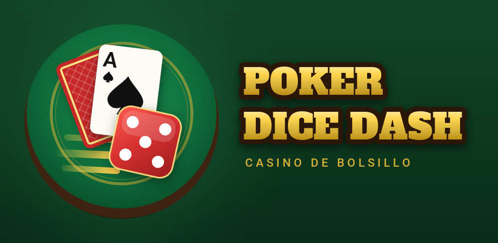

<p align="right"><a href="README.md">Español</a> · <b>English</b></p>

<p align="center">
  
</p>

<p align="center">
  <b>A pocket casino:</b> poker with dice, Texas Hold'em and Blackjack.<br>
  Play against bots or with your friends on the same Wi-Fi network. No accounts, no ads, no internet.
</p>

<p align="center">
  <a href="https://github.com/abdiCobos/pokerDiceDash/releases/latest"></a>
  
  <a href="LICENSE"></a>
</p>

> The game's interface is in Spanish.

## Screenshots

<table>
  <tr>
    <td width="50%"><p align="center">Dice Dash: poker with dice</p></td>
    <td width="50%"><p align="center">Texas Hold'em</p></td>
  </tr>
  <tr>
    <td width="50%"><p align="center">Blackjack</p></td>
    <td width="50%"><p align="center">Round results</p></td>
  </tr>
</table>

<p align="center">
  
  &nbsp;
  
</p>

## Download

| Platform | File |
|---|---|
| **Android** | `PokerDiceDash-<version>.apk` from [Releases](https://github.com/abdiCobos/pokerDiceDash/releases/latest) (F-Droid coming soon) |
| **Windows 10/11** | Installer `PokerDiceDash-<version>-setup.exe` or portable `PokerDiceDash-<version>-windows-x64.zip` from [Releases](https://github.com/abdiCobos/pokerDiceDash/releases/latest) |

> **Windows:** the game has no paid code-signing certificate, so SmartScreen may show "Windows protected your PC". Click **More info → Run anyway**. The first time you host a room, allow access on **private networks**.

## Game modes

### 🎲 Dice Dash: poker with dice
Before each move you roll two dice, and some combinations change the hand:

| Dice | Event |
|---|---|
| 1 + 1 | **Swap**: everyone's cards are shuffled and dealt again |
| 6 + 6 | **All-in**: the roller bets all their chips |
| 3 + 3 | **Spy**: you see one of an opponent's cards |
| 6 + 1 | **Extra card**: you get a third card and keep the best two |
| Sum 7 | **Lucky dice**: the pot grows by 30 % (once per hand) |

### ♠️ Texas Hold'em
Classic poker with blinds, side pots and the full rulebook.

### 🃏 Blackjack
Hit, stand, double down or split. Blackjack pays 3 to 2, the dealer stands on 17, 5-Card Charlie rule, and insurance when the dealer shows an Ace.

### 🤖 Bots with personality
Three levels (easy, normal and hard). They work out their odds, bluff, and each one plays differently.

## Local network multiplayer

- Host a room and join from other phones or Windows PCs on the **same Wi-Fi network**; you can also join by IP.
- Poker and Blackjack over the network, with an optional password.
- Automatic reconnection: if someone loses signal they get their seat back, and the table keeps going meanwhile.
- The host is in charge: each player only receives their own cards until the hand ends.
- No external servers: everything stays inside your network.

## Building from source

You need [Flutter](https://docs.flutter.dev/get-started/install) 3.38 or newer.

```bash
git clone https://github.com/abdiCobos/pokerDiceDash.git
cd pokerDiceDash
flutter pub get
flutter run
```

- **APK:** `flutter build apk --release`
- **Windows (ZIP and installer):** `powershell -ExecutionPolicy Bypass -File windows/packaging/build_release.ps1` (the installer needs [Inno Setup 6](https://jrsoftware.org/isinfo.php))
- **Tests:** `flutter test`

## License

Free software under **GPL-3.0-or-later**. See [LICENSE](LICENSE).
The title font, Alfa Slab One, is distributed under the SIL Open Font License (`assets/fonts/AlfaSlabOne-OFL.txt`).
