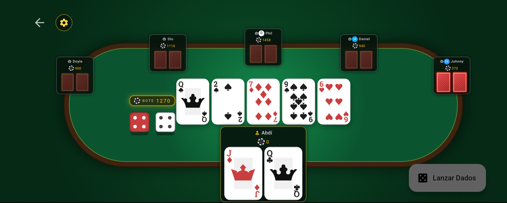
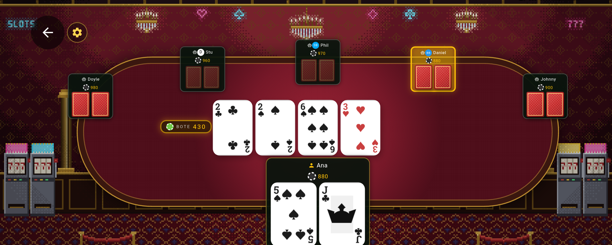
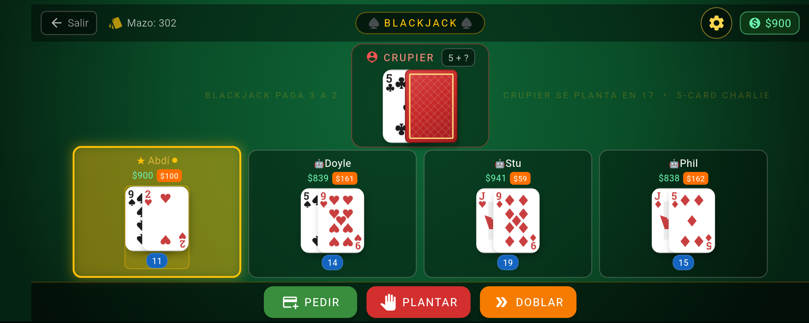
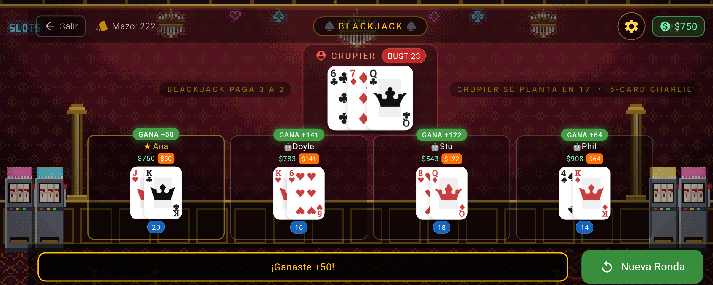
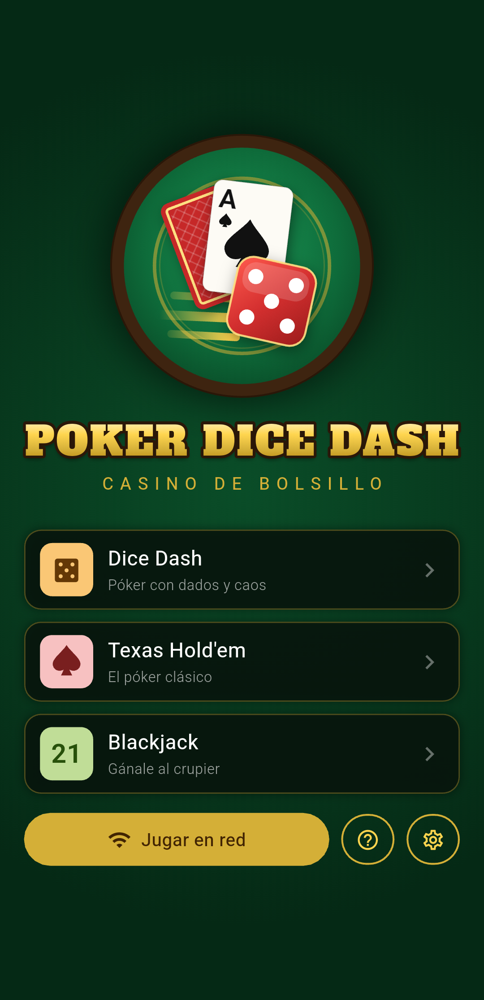
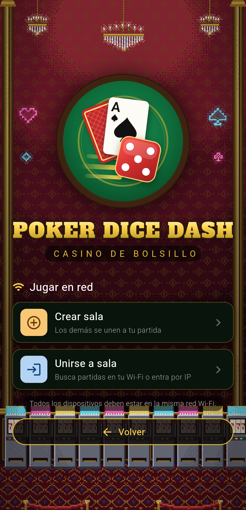
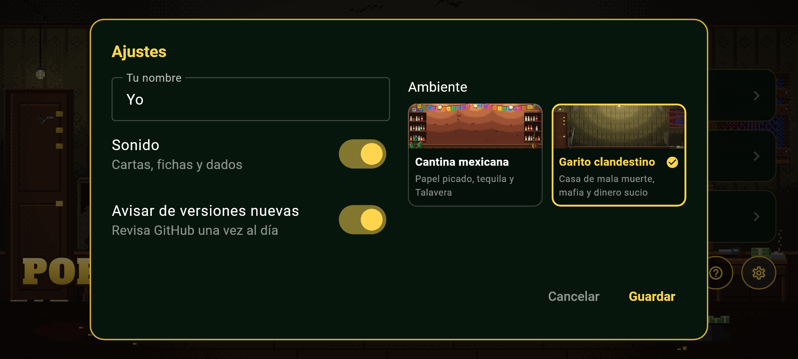
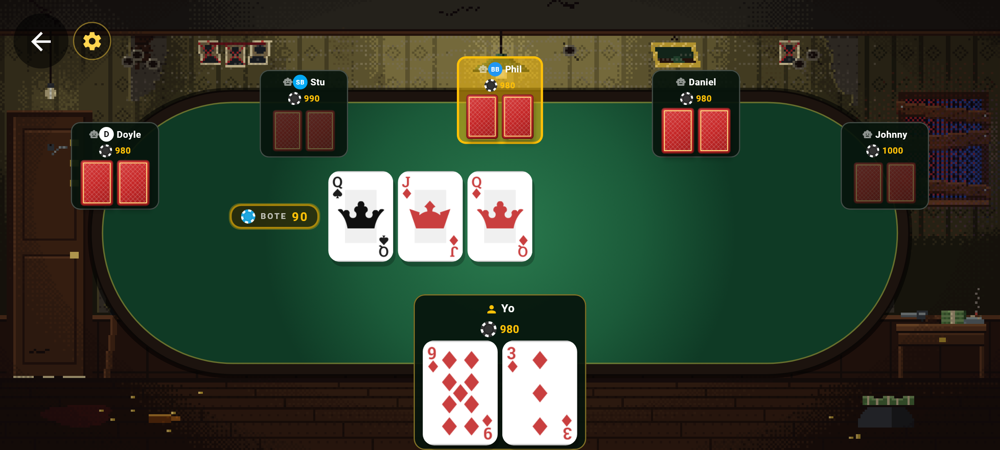

<p align="right"><b>Español</b> · <a href="README.en.md">English</a></p>

<p align="center">
  
</p>

<p align="center">
  <b>Casino de bolsillo:</b> póker con dados, Texas Hold'em y Blackjack.<br>
  Juega contra bots o con tus amigos en la misma red Wi-Fi. Sin cuentas, sin anuncios y sin servidores: solo se conecta a internet para avisarte de versiones nuevas (se apaga en Ajustes).
</p>

<p align="center">
  <a href="https://github.com/abdiCobos/pokerDiceDash/releases/latest"></a>
  
  <a href="LICENSE"></a>
</p>

## Capturas

<table>
  <tr>
    <td width="50%"><p align="center">Dice Dash: póker con dados</p></td>
    <td width="50%"><p align="center">Texas Hold'em</p></td>
  </tr>
  <tr>
    <td width="50%"><p align="center">Blackjack</p></td>
    <td width="50%"><p align="center">Resultados de la ronda</p></td>
  </tr>
</table>

<p align="center">
  
  &nbsp;
  
</p>

### Elige el ambiente

En **Ajustes → Ambiente** cambias el lugar donde se juega: una **Cantina mexicana** con papel picado, tequila y talavera, o un **Garito clandestino** de mala muerte, con mafia y dinero sucio. El menú y todas las mesas cambian con él.

<table>
  <tr>
    <td width="50%"><p align="center">Ajustes: elige el ambiente</p></td>
    <td width="50%"><p align="center">Texas Hold'em en el Garito clandestino</p></td>
  </tr>
</table>

## Descargar

| Plataforma | Archivo |
|---|---|
| **Android** | `PokerDiceDash-<versión>.apk` en [Releases](https://github.com/abdiCobos/pokerDiceDash/releases/latest) (pronto también en F-Droid) |
| **Windows 10/11** | Instalador `PokerDiceDash-<versión>-setup.exe` o versión portátil `PokerDiceDash-<versión>-windows-x64.zip` en [Releases](https://github.com/abdiCobos/pokerDiceDash/releases/latest) |

> **Windows:** el juego no tiene una firma digital de pago, así que SmartScreen puede mostrar «Windows protegió tu PC». Pulsa **Más información → Ejecutar de todas formas**. La primera vez que crees una sala, permite el acceso en **redes privadas**.

## Modos de juego

### 🎲 Dice Dash: póker con dados
Antes de cada jugada tiras dos dados, y algunas combinaciones cambian la mano:

| Dados | Evento |
|---|---|
| 1 + 1 | **Intercambio**: las cartas de todos se mezclan y se reparten otra vez |
| 6 + 6 | **All-in**: quien tira apuesta todas sus fichas |
| 3 + 3 | **Espía**: ves una carta de un rival |
| 6 + 1 | **Carta extra**: recibes una tercera carta y te quedas con las dos mejores |
| Suma 7 | **Dados de la suerte**: el bote crece un 30 % (una vez por mano) |

### ♠️ Texas Hold'em
El póker clásico con ciegas, botes paralelos y todo el reglamento.

### 🃏 Blackjack
Pide, plántate, dobla o divide. Blackjack paga 3 a 2, el crupier se planta en 17, regla 5-Card Charlie y seguro cuando el crupier muestra un As.

### 🤖 Bots con personalidad
Tres niveles (fácil, normal y difícil). Calculan sus probabilidades, farolean y cada uno juega distinto.

## Multijugador en red local

- Crea una sala y únete desde otros móviles o PC con Windows en la **misma red Wi-Fi**; también puedes entrar por IP.
- Póker y Blackjack en red, con contraseña opcional.
- Reconexión automática: si alguien pierde la señal recupera su asiento, y mientras tanto la mesa sigue.
- El anfitrión manda: cada jugador solo recibe sus propias cartas hasta el final de la mano.
- Sin servidores externos: todo ocurre dentro de tu red.

## Compilar desde el código

Necesitas [Flutter](https://docs.flutter.dev/get-started/install) 3.38 o superior.

```bash
git clone https://github.com/abdiCobos/pokerDiceDash.git
cd pokerDiceDash
flutter pub get
flutter run
```

- **APK:** `flutter build apk --release`
- **Windows (ZIP e instalador):** `powershell -ExecutionPolicy Bypass -File windows/packaging/build_release.ps1` (el instalador requiere [Inno Setup 6](https://jrsoftware.org/isinfo.php))
- **Pruebas:** `flutter test`

## Para desarrolladores: el motor por separado

Las reglas de Texas Hold'em y Blackjack del juego también están disponibles como paquete independiente de Dart, **[card_table_engine](https://pub.dev/packages/card_table_engine)**, para que cualquiera pueda usarlas en sus propios juegos sin empezar de cero: evaluador de manos, botes paralelos, mesa completa de Texas Hold'em, mesa de Blackjack y bots. Es Dart puro (funciona en Flutter, servidores y consola) y tiene licencia **MIT**.

```sh
dart pub add card_table_engine
```

Código y documentación: [github.com/abdiCobos/card_table_engine](https://github.com/abdiCobos/card_table_engine)

## Licencia

Software libre bajo **GPL-3.0-or-later**. Ver [LICENSE](LICENSE).
La fuente del título, Alfa Slab One, se distribuye bajo la licencia SIL Open Font License (`assets/fonts/AlfaSlabOne-OFL.txt`).
